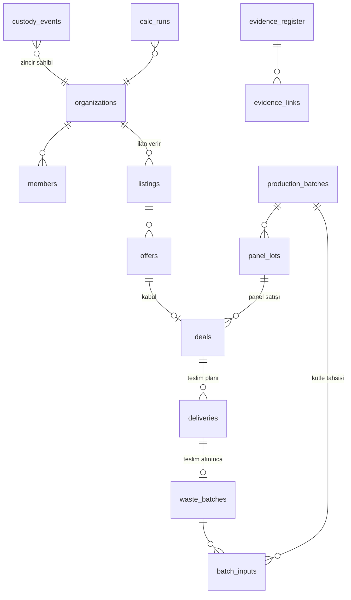

# ReBoard platformu: mimari

> Bu dosya sistemin **şu anki** hâlini anlatır. Mimari değiştiğinde aynı commit'te güncellenir. Kararların gerekçesi `docs/DECISIONS.md` dosyasındadır.

## 1. Amaç ve sınırlar

ReBoard platformu üç işi yapar:

1. **Pazar yeri:** Atık tekstil sağlayıcılarını (tekstil fabrikası, belediye, geri dönüşüm tesisi) ReBoard üreticisi ve panel alıcılarıyla (mobilya, inşaat) buluşturur.
2. **Tedarik sürekliliği:** Hammadde stokunu, kaç günlük hammadde kaldığını, planlı teslimleri, tedarikçi güvenilirliğini ve uyarıları izler.
3. **Güven:** Geri kazanılan atığı çift taraflı tartımla doğrular; gözetim zincirini değiştirilemez bir olay günlüğünde tutar; her panel lotuna açık bir dijital ürün pasaportu verir.

Kapsam dışı (D-015): canlı GPS, yapay zekâ ile rota optimizasyonu, ödeme, karbon kredisi, blokzincir, mobil uygulama.

## 2. Bileşenler

```mermaid
flowchart LR
  subgraph Tarayıcı
    S[Hikâye sayfası<br/>kare dizisi oynatıcı]
    A[Uygulama ekranları<br/>pazar · izlenebilirlik · panel · senaryo]
    P[Açık pasaport ve doğrulama]
  end
  subgraph Next.js 16 sunucusu, Vercel fra1
    RSC[Server Components<br/>okuma]
    SA[Server Actions<br/>Zod ile doğrulama ve yetki]
    API[Route Handlers<br/>/api/auth · /api/verify · /api/cron]
    D[Alan katmanı src/domain<br/>calc · traceability · impact · supply]
    R[Repository katmanı src/db/repo<br/>withTenant]
  end
  DB[(Postgres<br/>Neon Frankfurt<br/>çevrimdışı: PGlite)]
  S --> RSC
  A --> RSC & SA
  P --> RSC & API
  RSC & SA & API --> D --> R --> DB
```

| Katman | Klasör | Kural |
| --- | --- | --- |
| Sayfalar | `src/app/[locale]/…` | Yalnızca sunum. İş kuralı içermez |
| Bileşenler | `src/components/…` | `ui/`: temel bileşenler. `story/`: kare dizisi oynatıcı. `charts/`, `map/`, `trace/`: soy ağacı |
| Sunucu eylemleri | `src/server/actions/…` | Her eylem Zod şemasıyla doğrular, oturumu ve rolü denetler, repository'ye gider |
| Alan | `src/domain/…` | Saf TypeScript. I/O yok, birim testli. Tek gerçek kaynak burası |
| Repository | `src/db/repo/…` | Bütün özel sorgular `withTenant(orgId)` üzerinden geçer (D-016) |
| Şema | `src/db/schema/…` | Drizzle. Migrasyonlar `drizzle/` klasöründe |
| Tasarım | `src/design/` | `wada.json`: sözlüğün 159 rengi (MIT, `WADA_LICENSE.md`). `tokens.ts`: Wada adlarıyla tanımlı paletler ve `<html>` üzerine yazılan CSS değişkenleri. `color.ts`: kontrast, OKLab ΔE, ton farkı ve CVD benzetimi; testler ve palet önizlemesi bunu kullanır |
| Çeviri | `messages/{tr,en}.json`, `src/i18n/` | next-intl. `src/proxy.ts` dil önekini yönetir (`/` → `/tr` ya da `/en`; API ve uzantılı dosyalar hariç). Anahtarların iki dilde eşit olduğu test edilir |
| Kimlik | `src/lib/auth.ts` | `getAuth()` tembel başlatılır; build sırasında veritabanı ve secret denetimi tetiklenmez. Uç: `src/app/api/auth/[...all]/route.ts` |
| Veritabanı istemcisi | `src/db/client.ts` | `getDb()`: `DATABASE_URL` varsa node-postgres, yoksa `.data/pglite`. Migrasyon: `pnpm db:migrate` (`scripts/db-migrate.ts`) |

## 3. Veri modeli

Tabloların tamamı `src/db/schema/` altında. Ortak kurallar:

- Boş değer bilinmeyen demektir (D-011). Kolon boş bırakılabilir; arayüz "bilinmiyor" yazar.
- Para `numeric(14,2)` olarak, `currency` (TRY, EUR, USD) ve `tax_basis` (`incl_vat` ya da `excl_vat`) alanlarıyla birlikte saklanır.
- Miktarlar `numeric` ve birim enum'uyla saklanır (`kg`, `t`, `m2`, `kwh`, `h`).
- Zaman damgaları `timestamptz` olur.
- Özel tablolarda `org_id` kolonu bulunur.



| Grup | Tablolar |
| --- | --- |
| Kimlik | Better Auth tabloları (`user`, `session`, `account`, `verification`, `organization`, `member`, `invitation`) ve `org_profiles`. `org_profiles` organizasyon türünü, ilçeyi, yuvarlanmış konumu ve paylaşım durumunu tutar |
| Pazar yeri | `listings` (türler: `waste_offer`, `waste_request`, `panel_offer`, `panel_request`), `offers`, `deals`, `deliveries` |
| İzlenebilirlik | `waste_batches`, `production_batches`, `batch_inputs`, `panel_lots`, `custody_events`, `evidence_register`, `evidence_links` |
| Ekonomi | `supplier_baseline`, `transport_quotes`, `cost_lines`, `buyer_trials`, `transactions`, `saas_costs`, `model_inputs`, `calc_runs`. Bunlar Şerife'nin raporundaki tablolar |
| Referans | `reference_values`: değer, birim, kaynak URL'si, indirme tarihi, lisans, kapsam notu ve sonuç sınıfı |

Alanların anlamları ve birimleri `docs/DATA_DICTIONARY.md` dosyasında.

## 4. Gözetim zinciri ve olay modeli (D-012)

- Olaylar EPCIS 2.0'dan gelir:
  - `ObjectEvent`: kabul, tartım, denetim.
  - `TransformationEvent`: atık partisinin üretim partisine, üretim partisinin panel lotuna dönüşmesi.
  - `TransactionEvent`: anlaşma ve satış.
- `biz_step` değerleri CBV sözlüğünden gelir: `receiving`, `inspecting`, `commissioning`, `shipping`, `transforming`, `accepting`.
- Her olayda şunlar bulunur: `event_time`, `org_id`, `inputs[]` ve `outputs[]` (her biri `{ref, kg}`), `evidence_ids[]`, `prev_hash` ve `hash`.
- Hash `hash = sha256(canonicalJson(payload) + prev_hash)` olarak hesaplanır. Kanonik JSON'da anahtarlar sıralanır ve sayılar sabit ondalıkla yazılır. Zincir organizasyon başına tutulur.
- Kayıtlar yalnızca eklenir. `custody_events` tablosundaki UPDATE ve DELETE işlemlerini bir trigger reddeder; bu kural migrasyonda tanımlıdır.
- Doğrulama `/api/verify/[lot]` ucunda yapılır. Uç, lotun soy ağacındaki olay zincirini baştan yeniden hesaplar ve sonucu `{ok, brokenAt?}` olarak döner.
- Kütle dengesinde girdiler toplamı, çıktılar, fire, nem ve buhar kaybının toplamına eşit olmalıdır: `Σ inputs.kg = Σ outputs.kg + fire_kg + moisture_loss_kg`. Varsayılan tolerans %2'dir. Tolerans aşılırsa açıklama alanı zorunlu olur.

## 5. Alan modülleri (`src/domain`)

| Modül | İçerik |
| --- | --- |
| `result.ts` | `Result<T>` tipi `{value: Decimal \| null, unit, period, currency?, taxBasis?, resultClass, inputRefs, formulaVersion}`. `null` "bilinmiyor" anlamına gelir |
| `calc/` | Fabrika kazancı, panel müşterisi kazancı, ReBoard faaliyet sonucu, fiyat koridoru ve SaaS katkısı. Para birimi, vergi temeli ya da dönem uyuşmazsa `CalcError` fırlatır |
| `traceability/` | `canonicalJson`, `hashEvent`, `verifyChain`, `massBalance`, `genealogy(lotId)` |
| `impact/` | `recoveredKg({verifiedOnly})`, `inPanelKg`, `co2eRange(kg, factors)`. CO₂e alt ve üst sınırla, kaynağıyla birlikte döner |
| `supply/` | `inventoryKg`, `daysOfCover`, `projectedCover(deliveries)`, `supplierReliability`, `hhi`, `matchScore(listing, need)` |

## 6. Kimlik, roller ve kiracılar

- Better Auth kullanılır: e-posta ve parola, oturum çerezi, organizasyon eklentisi.
- Roller:
  - `owner` ve `admin`: her şeyi yapabilir.
  - `operator`: kayıt girer.
  - `viewer`: yalnızca okur.
- Herkese açık sayfalar: `/`, `/pasaport/[lot]`, `/api/verify/[lot]` ve etki sayacı.
- Demo modunda "demo rolüyle gir" düğmesi bulunur. Seçenekler: Sağlayıcı (Ege Tekstil), Üretici (ReBoard), Alıcı (Akdeniz Mobilya).

## 7. Hikâye sayfası (D-004)

`story/blender/*.py` dosyaları Blender 4.5'te render edilir ve ham PNG kareler `story/out/` klasörüne yazılır. `scripts/story-encode.mjs` bu kareleri sharp ile AVIF ve WebP'ye çevirip `public/story/{d,m}/` altına koyar ve `manifest.json` üretir. Sayfada `FrameSequencePlayer` bu kareleri oynatır. Ayrıntılar `docs/STORY.md` dosyasında.

## 8. Güvenlik

- Server Actions girdiyi Zod ile doğrular ve rolü denetler.
- `next.config.ts` üzerinden güvenlik başlıkları uygulanır: CSP, `X-Content-Type-Options`, `Referrer-Policy`.
- Kanıt dosyalarında yalnızca PDF, PNG, JPEG ve WebP kabul edilir; dosya en fazla 5 MB olabilir ve SHA-256 özeti tutulur.
- Gizli bilgiler yalnızca ortam değişkenlerinde durur; CI'da gitleaks çalışır. `.env.example` dosyası yalnızca anahtar adlarını içerir.
- Log'larda kişisel veri tutulmaz. Konum ilçe düzeyinde ya da yaklaşık 1 km'ye yuvarlanmış olarak saklanır.

## 9. Dağıtım (D-003)

| Ortam | Uygulama | Veritabanı |
| --- | --- | --- |
| Yerel geliştirme | `pnpm dev` | PGlite (`.data/pglite`) |
| Test | Vitest ve Playwright | PGlite (bellek ya da geçici klasör) |
| Çevrimdışı demo | `pnpm demo:offline` (production build) | PGlite ve seed |
| Canlı | Vercel, fra1 | Neon, `aws-eu-central-1` |

- Ortam değişkenleri:
  - `DATABASE_URL`: boşsa PGlite kullanılır.
  - `BETTER_AUTH_SECRET`, `BETTER_AUTH_URL`
  - `DEMO_MODE`, `DEMO_PASSWORD`
  - `CRON_SECRET`
- CI (GitHub Actions) sırasıyla şunları çalıştırır: lint, tip denetimi, Vitest, Playwright (Chromium), `docs:check` ve gitleaks.
