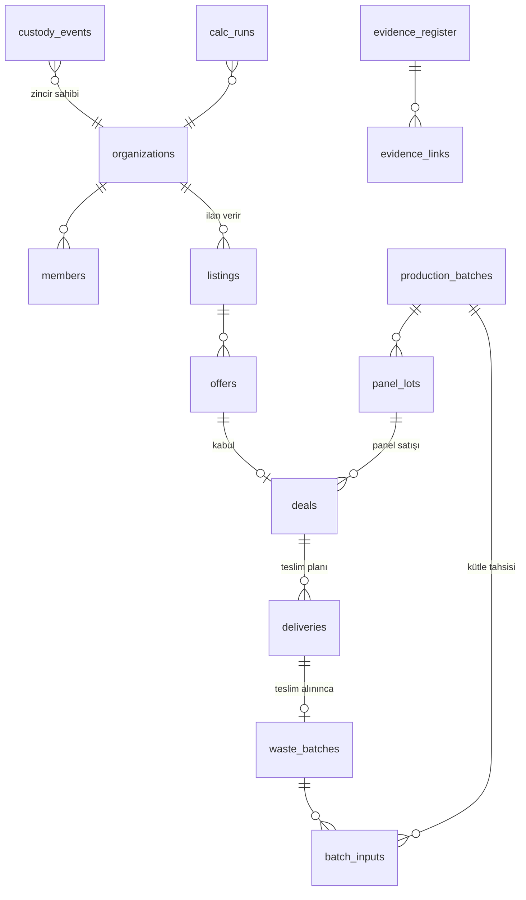

# ReBoard platformu: mimari

> Bu dosya sistemin **şu anki** hâlini anlatır. Mimari değiştiğinde aynı commit'te güncellenir. Kararların gerekçesi `docs/DECISIONS.md` dosyasındadır.

## 1. Amaç ve sınırlar

ReBoard platformu üç işi yapar:

1. **Pazar yeri:** Atık tekstil sağlayıcılarını (tekstil fabrikası, belediye, geri dönüşüm tesisi) ReBoard üreticisi ve panel alıcılarıyla (mobilya, inşaat) buluşturur.
2. **Tedarik sürekliliği:** Hammadde stokunu, kaç günlük hammadde kaldığını, planlı teslimleri, tedarikçi güvenilirliğini ve uyarıları izler.
3. **Güven:** Geri kazanılan atığı çift taraflı tartımla doğrular; gözetim zincirini değiştirilemez bir olay günlüğünde tutar; her panel lotuna açık bir dijital ürün pasaportu verir.

Kapsam dışı (D-015): canlı GPS, yapay zekâ ile rota optimizasyonu, ödeme, karbon kredisi, blokzincir, mobil uygulama.

## 2. Bileşenler

```mermaid
flowchart LR
  subgraph Tarayıcı
    S[Hikâye sayfası<br/>kare dizisi oynatıcı]
    A[Uygulama ekranları<br/>pazar · izlenebilirlik · panel · senaryo]
    P[Açık pasaport ve doğrulama]
  end
  subgraph Next.js 16 sunucusu, Vercel fra1
    RSC[Server Components<br/>okuma]
    SA[Server Actions<br/>Zod ile doğrulama ve yetki]
    API[Route Handlers<br/>/api/auth · /api/evidence · /api/verify · /api/counter]
    D[Alan katmanı src/domain<br/>calc · traceability · impact · supply]
    R[Repository katmanı src/db/repo<br/>withTenant]
  end
  DB[(Postgres<br/>Neon Frankfurt<br/>çevrimdışı: PGlite)]
  S --> RSC
  A --> RSC & SA
  P --> RSC & API
  RSC & SA & API --> D --> R --> DB
```

| Katman | Klasör | Kural |
| --- | --- | --- |
| Sayfalar | `src/app/[locale]/…` | Yalnızca sunum. İş kuralı içermez |
| Bileşenler | `src/components/…` | `ui/`: temel bileşenler. `story/`: kare dizisi oynatıcı. `market/`: ilan kartı, fiyat metni, ilan haritası (`MarketMap`). `trace/`: kabul, kanıt ve üretim formları (`keep.ts`: hata dönüşünde girilen değerler silinmez), olay zaman çizelgesi, zincir durumu, miktar (`Qty`, `data-kg`) ve kaydırılan tablo kabı (`TableWrap`). `panel/`: sınıf rozetli gösterge (`Kpi`, `KgTotalText`), simge ve yazılı durum çipi (`StatusChip`), bağımlılıksız SVG grafikler (`Charts.tsx`: `ProjectionChart`, `MonthlyChart`; klavye imleci, `aria-live` duyurusu) ve React'sız saf yerleşim modülü (`chart-layout.ts`: ölçek, kesin çakışma geometrisi, kısa biçim ve çizgi üstü yedekli etiket yerleşimi) |
| Sunucu eylemleri | ilgili rota klasöründe `actions.ts` | Her eylem `src/lib/action.ts` kapısından geçer (oturum → rol → Zod), sonra repository'ye gider |
| Alan | `src/domain/…` | Saf TypeScript. I/O yok, birim testli. Tek gerçek kaynak burası |
| Repository | `src/db/repo/…` | Bütün özel sorgular `withTenant(orgId)` üzerinden geçer (D-016) |
| Şema | `src/db/schema/…` | Drizzle. Migrasyonlar `drizzle/` klasöründe |
| Tasarım | `src/design/` | `wada.json`: sözlüğün 159 rengi (MIT, `WADA_LICENSE.md`). `tokens.ts`: Wada adlarıyla tanımlı ana palet (#343), durum renkleri (`STATUS`) ve `<html>` üzerine yazılan CSS değişkenleri. `color.ts`: kontrast, OKLab ΔE, ton farkı ve CVD benzetimi; testler bunu kullanır. `map.ts`: harita noktası renkleri, ölçülen altlık örnekleri ve dokunma yarıçapı (M-22) |
| Çeviri | `messages/{tr,en}.json`, `src/i18n/` | next-intl. `src/proxy.ts` dil önekini yönetir (`/` → `/tr` ya da `/en`; API ve uzantılı dosyalar hariç). Anahtarların iki dilde eşit olduğu test edilir |
| Kimlik | `src/lib/auth.ts`, `src/lib/viewer.ts` | `getAuth()` tembel başlatılır; build sırasında veritabanı ve secret denetimi tetiklenmez. `createAuth(db, ayarlar)` testlerde PGlite ile kurulur. `getViewer()` sayfaların ve eylemlerin tek kimlik kaynağıdır (`server-only`). Uç: `src/app/api/auth/[...all]/route.ts` |
| Veritabanı istemcisi | `src/db/client.ts` | `getDb()`: `DATABASE_URL` varsa node-postgres, yoksa `.data/pglite`. Migrasyon: `pnpm db:migrate` (`scripts/db-migrate.ts`) |

## 3. Veri modeli

Tabloların tamamı `src/db/schema/` altında. Ortak kurallar:

- Boş değer bilinmeyen demektir (D-011). Kolon boş bırakılabilir; arayüz "bilinmiyor" yazar.
- Para `numeric(14,2)` olarak, `currency` (TRY, EUR, USD) ve `tax_basis` (`incl_vat` ya da `excl_vat`) alanlarıyla birlikte saklanır.
- Miktarlar `numeric` ve birim enum'uyla saklanır. Birimlerin listesi `docs/DATA_DICTIONARY.md` dosyasında.
- Zaman damgaları `timestamptz` olur.
- Özel tablolarda `org_id` kolonu bulunur.



| Grup | Tablolar |
| --- | --- |
| Kimlik | Better Auth tabloları (`user`, `session`, `account`, `verification`, `organization`, `member`, `invitation`) ve `org_profiles`. `org_profiles` organizasyon türünü, ilçeyi, yuvarlanmış konumu ve paylaşım durumunu tutar |
| Pazar yeri | `listings` (türler: `waste_offer`, `waste_request`, `panel_offer`, `panel_request`), `offers`, `deals`, `deliveries` |
| İzlenebilirlik | `waste_batches`, `production_batches`, `batch_inputs`, `panel_lots`, `custody_events`, `evidence_register`, `evidence_links` |
| Ekonomi | `supplier_baseline`, `transport_quotes`, `cost_lines`, `buyer_trials`, `transactions`, `saas_costs`, `model_inputs`, `calc_runs`. Bunlar Şerife'nin raporundaki tablolar |
| Referans | `reference_values`: değer, birim, kaynak URL'si, indirme tarihi, lisans, kapsam notu ve sonuç sınıfı |

Alanların anlamları ve birimleri `docs/DATA_DICTIONARY.md` dosyasında.

**Pazar yeri yazımları** (`src/db/repo/market.ts`, D-021) yalnızca bu fonksiyonlardan geçer; kurallar `src/domain/market.ts` içindedir:

- `createListing`: konum kurum profilinden kopyalanır; fiyat birimi ilanın birimidir.
- `placeOffer`: ilan `withTenant` ile okunur; görünmeyen ilan "yok" hatası verir. Birim, para birimi ve vergi temeli ilandan gelir.
- `acceptOffer` tek işlemdir: teklif `status = 'open'` koşuluyla güncellenir, tek seferlik ilan kapanır, diğer açık teklifler reddedilir, `deals` ve planlı `deliveries` yazılır. Kural ihlalinde işlem geri alınır. `deals` ve `deliveries` başka yoldan yazılmaz.
- `rejectOffer`, `withdrawOffer` koşullu güncellemedir; `closeListing` `assertOwns` sonrası ilanı kapatır ve açık teklifleri reddeder.
- Okuma: `listMarket` (süzgeç, eşleşme skoru, güvenilirlik) ve `listingDetail` (teklifler, anlaşmalar, teslimler). İkisi de yalnızca `withTenant` görünürlüğüyle okur.
- `drizzle/0004_teslim_kutlesi_bos.sql`: `deliveries.planned_kg` boş bırakılabilir (m² teslim).
- Server Action'lar `src/app/[locale]/(app)/pazar/actions.ts` içindedir: oturum → rol → Zod → depo. Hata kodu `market.errors.*` metnine çevrilir; yok ile yetkisiz aynı koddur (`not_found`). Tek düğmeli eylemler sonucu `?durum=` ya da `?hata=` ile ilan sayfasına döndürür; JavaScript olmadan da çalışır.
- İlan haritası (D-022) `src/components/market/MarketMap.tsx` istemci bileşenidir. MapLibre GL 6 dinamik içe aktarılır, yani yalnızca `/pazar` açılınca yüklenir. İşçi dosyası `maplibre-gl-worker.mjs`, `new URL(…, import.meta.url)` ile Turbopack'e statik varlık olarak kopyalatılır. Altlık OpenFreeMap "positron"dır. Gruplama `groupByPoint` (`src/domain/geo.ts`) ile yapılır; renkler `src/design/map.ts` dosyasından gelir.

## 4. Gözetim zinciri ve olay modeli (D-012)

- Olaylar EPCIS 2.0'dan gelir:
  - `ObjectEvent`: kabul, tartım, denetim.
  - `TransformationEvent`: atık partisinin üretim partisine, üretim partisinin panel lotuna dönüşmesi.
  - `TransactionEvent`: anlaşma ve satış.
- `biz_step` değerleri CBV sözlüğünden gelir: `receiving`, `inspecting`, `commissioning`, `shipping`, `transforming`, `accepting`.
- Her olayda şunlar bulunur: `org_id`, `seq`, `type`, `biz_step`, `event_time`, `payload`, `prev_hash` ve `hash`. `payload` jsonb'dir: `inputs[]` ve `outputs[]` (her biri `{ref, kg}`), `evidenceIds[]` ve isteğe bağlı `note`.
- Hash şöyle hesaplanır: `hash = sha256(canonicalJson({orgId, seq, type, bizStep, eventTime, payload}) + prev_hash)`. `eventTime` ISO 8601 UTC metnidir.
  - Kanonik JSON'da anahtarlar sıralanır. Yalnızca güvenli tamsayılar kabul edilir; kg değerleri `"1250.500"` gibi 3 ondalıklı metin olarak yazılır. Böylece jsonb ve `timestamptz` gidiş-dönüşünden sonra hash değişmez.
  - SHA-256 `@noble/hashes` ile hesaplanır; aynı kod sunucuda ve tarayıcıda çalışır.
  - Zincir organizasyon başına tutulur: ilk olayın `seq` değeri 1, `prev_hash` değeri 64 sıfırdır (`GENESIS_HASH`).
- `verifyChain(events, anchor?)` olayları sırayla denetler: sıra numarası, organizasyon, önceki hash ve hash'in yeniden hesaplanması. Bozulma varsa `{ok: false, brokenAt, reason}` döner; `reason` şunlardan biridir: `seq_gap`, `org_mismatch`, `prev_hash_mismatch`, `hash_mismatch`, `anchor_mismatch`.
- **Bilinen sınır ve çapa:** Veritabanına tam erişimi olan biri bir olayı değiştirip ondan sonraki bütün hash'leri yeniden hesaplarsa, ya da sondan olay silerse zincir kendi içinde tutarlı kalır. Bunu yalnızca daha önce dışarıya verilmiş bir çapa (`{count, head}`) yakalar. Lotun etiket çapası pasaportun QR adresinde yayımlanır (D-025); dışa aktarım Faz 5'tedir.
- Yazma ve okuma `src/db/repo/custody.ts` üzerinden yapılır. `appendCustodyEvent` bir işlem içinde zincirin ucunu okur, sonraki olayı hesaplar ve ekler; `(org_id, seq)` çakışırsa 3 kez yeniden dener. `listCustodyEvents(db, orgId)` yalnızca o kurumun zincirini `seq` sırasıyla döndürür; ekranlar onu oturumdaki kurumla çağırır.
- İzlenebilirlik yazımları `src/db/repo/trace.ts` içindedir; her biri tek işlemde kaydı ve zincir olayını birlikte yazar, biri düşerse ikisi de yazılmaz:
  - `receiveDelivery`: planlı teslimi kapatır, atık partisini yazar (`WB-yyyy-nnnn`), `receiving` ve ayıklama varsa `inspecting` olayı ekler.
  - `uploadEvidence`: dosyayı `EvidenceStore`'a, özetini kanıt kaydına yazar, partiye bağlar ve notunda SHA-256 bulunan bir `inspecting` olayı ekler.
  - `checkEvidence`: kanıtı beyandan belgeliye geçirir ve bağlı partileri D-013'e göre yeniden doğrular.
  - `createProduction`: partileri kilitleyip yalnızca doğrulanmış ve kalanı yeten partilerden tahsis alır, kütle dengesini denetler (`productionError`), isterse panel lotunu açar ve `transforming` olayını ekler. Ekran stok listesini aynı kuralla süzer (`producible`).
  - Kurallar `src/domain/traceability/batches.ts` içindedir; ihlal `TraceRuleError` kodu olarak eyleme döner ve formda çevrilmiş metinle gösterilir.
- Kayıtlar yalnızca eklenir (`drizzle/0002_append_only.sql`):
  - Satır düzeyindeki UPDATE ve DELETE işlemlerini bir tetikleyici her zaman reddeder. Organizasyon silinmesinden gelen cascade de reddedilir; zinciri olan organizasyon silinemez.
  - TRUNCATE yalnızca demo sıfırlamasında, aynı işlemde `SET LOCAL reboard.allow_reset = 'on'` ile çalışır.
  - `(org_id, seq)` benzersizdir; aynı sıra numarasıyla ikinci kayıt (zincir çatallanması) yazılamaz. Eşzamanlı yazımda repository yeniden dener.
- **Açık pasaport** (D-025): `src/db/repo/passport.ts` içindeki `publicPassport(db, kod, çapa?)` iki adımda çalışır.
  1. Yalnızca açık lotu bulur ve `lotGraph` ile lotun sahibinin gözüyle okur. İç lot sayfası (`lotGenealogy`) da aynı grafiği kullanır, bu yüzden iki sayfadaki sayılar aynıdır.
  2. Soy ağacındaki kodlara (lot, üretim partisi, atık partileri) dokunan zincirleri `payload` jsonb içerme sorgusuyla bulur. Her zinciri `verifyChain` ile ilk olaydan başlayarak yeniden hesaplar; üretici zincirini istenirse etiket çapasıyla da denetler.
  - Dışarı çıkan alanları `src/domain/traceability/passport.ts` seçer:
    - `publicEvent`: not ve kanıt çıkarılır, yalnızca soy ağacı nesneleri kalır.
    - `publicVerdict`: adı gizli zincirde olay sayısı ve uç yazılmaz.
    - Ayrıca `chainRole`, `lotAnchor`, `anchorStatus` ve `fibreRows`.
  - `/[locale]/pasaport/[lot]` sayfası sunucuda çizilir. QR, `src/components/passport/qr.ts` içindeki `qrPath` ile tek bir SVG yoluna çevrilir. `VerifyButton` aynı ucu tarayıcıdan yeniden çağırır.
  - `/api/verify/[lot]?a=<çapa>` ucu üç yanıt verir: 200 ve hüküm; okunamayan çapada 400; lot yoksa ya da açık değilse 404.
- **Herkese açık sayaç** (D-013): `src/db/repo/counter.ts` içindeki `impactCounter(db)` doğrulanmış bütün atık partilerini okur ve `publicCounter` (`src/domain/impact.ts`) ile toplar. Kiracı katmanından geçmez. Dışarı yalnızca platform geneli kabul edilen kg, parti sayısı ve en zayıf sonuç sınıfı çıkar; kurum, parti kodu ve dönem çıkmaz. Doğrulanmış parti yoksa `null` döner ve sayaç gösterilmez.
- Kütle dengesi (`massBalance`): `|Σ girdi − çıktı − fire − nem kaybı| ÷ Σ girdi ≤ %2`. Tolerans aşılırsa açıklama zorunludur (`balanceNoteMissing`). Değerlerden biri bilinmiyorsa ya da girdi 0 ise denge iddia edilmez (`withinTolerance: null`). Negatif kg reddedilir.
- Soy ağacı (`genealogy(lotId)`): panel lotundan üretim partisine, oradan atık partilerine iner. Lotun payı, partide tek lot varsa 1, yoksa alan oranıdır; herhangi bir lotun alanı bilinmiyorsa pay da bilinmez. Sonuç; lotun tekstil kg'ını, bunun doğrulanmış kısmını, sağlayıcıya ve life göre dağılımını ve en zayıf sonuç sınıfını verir. Lot sayfasında iç içe liste olarak gösterilir (D-023).

- Etki ve tedarik paneli `src/db/repo/panel.ts` içindeki `panelData(db, orgId, now)` ile okunur. Fonksiyon yalnızca okur: kurumun gördüğü partileri, üretimleri, lotları, atık anlaşmalarının teslimlerini ve `model_inputs` içindeki ihtiyaç ve eşik girdilerini `withTenant` ile toplar. Hesabı `impactSummary` ve `supplyView` yapar. Panel teslimi stoğa girmez; hammadde akışı yalnızca atık ilanlarından doğan anlaşmalardır.

## 5. Alan modülleri (`src/domain`)

| Modül | İçerik |
| --- | --- |
| `result.ts` | `Result` tipi `{value: Decimal \| null, unit, period, currency?, taxBasis?, resultClass, inputRefs, formulaVersion, conditions}`. `null` "bilinmiyor" anlamına gelir. `weakestClass` sonucun sınıfını girdilerin en zayıfından türetir |
| `calc/` | `money.ts`: kalem toplama ve `null` yayılımı. `formulas.ts`: fabrika kazancı, panel müşterisi kazancı, ReBoard faaliyet sonucu, fiyat koridoru ve SaaS katkısı. `synthetic-scenario.ts`: senaryo ekranının 23 girdisi ve her birinin dayanağı (`basis`), kaynaklı varsayılan girdiler (`SOURCED_SCENARIO`: yalnızca ekip planındaki ayda 10 t, D-029), form metni ile girdi arasındaki dönüşüm ve kırmızı gösterilecek sonuçlar (`scenarioAlerts`). Rapordaki sentetik örnek yalnızca testte durur (`tests/fixtures/report-scenario.ts`). Senaryo ekranı bu işlevleri tarayıcıda çağırır; seed'deki `calc_runs` aynı işlevle üretilir (D-026). Karşılaştırma için kaynaklı değerleri `src/db/repo/scenario.ts` içindeki `scenarioReferences(tenant)` okur; hesaba girmezler (D-029). `saas-costs.ts`: SaaS gider tablosunun kurulum toplamları (`saasStageSummary`); bilinmeyen kalem toplamı bilinmiyor yapar, bilinen kısım alt sınırdır, USD tutarlar kurla TL'ye çevrilir (D-027). Satırları ve kuru `src/db/repo/saas.ts` içindeki `saasCostData(tenant)` okur. Para birimi, vergi temeli, dönem ya da birim uyuşmazsa, hiç girdi yoksa `CalcError` fırlatır |
| `traceability/` | `canonical.ts`: `canonicalJson`, `kgText`. `chain.ts`: `hashEvent`, `nextEvent`, `verifyChain`. `mass-balance.ts`: `massBalance`, `balanceNoteMissing`. `genealogy.ts`: `genealogy(lotId, graph)`, `splitByComposition`. Lif listesi `src/domain/fibre.ts` dosyasında |
| `impact.ts` | `kgTotal` (bilinen toplam ve bilinmeyen kalem sayısı; alt sınır), `classOf` (en zayıf sınıf), `monthsBack` (Türkiye takvimiyle aylar), `impactSummary` (doğrulanmış, beyan edilen ve panele giren kg; karşı taraf payları; ilk kaydın ayından başlayan en çok 6 aylık trend). CO₂e hesaplanmaz; doğrulanmış katsayı kaynağı yok |
| `market.ts` | İlan türleri ve birimleri, taraflar, ödeme yönü, ilan, teklif, yanıt ve geri çekme kuralları, teslim planı (`deliveryPlan`), eşleşme skoru (`matchScore`, `compositionFit`), İstanbul takvim günü (D-021) |
| `supply.ts` | `onTimeRate`, `coverThresholds`, `daysOfCover`, `coverLevel`, `projectStock` (30 gün, günlük adım), `hhi` (son 90 gün, 1.800 eşiği), `supplyView` (üretime hazır stok, doğrulama bekleyen, uyarılar, tedarikçi satırları; D-024) |
| `fibre.ts`, `geo.ts`, `access.ts`, `panel.ts` | Lif listesi ve bileşim payları; kuş uçuşu mesafe; roller; panel ölçüleri |

## 6. Kimlik, roller ve kiracılar

- Better Auth kullanılır: e-posta ve parola, oturum çerezi, organizasyon eklentisi (D-010).
- **Hesap açma kapalı:** `disableSignUp` ve `allowUserToCreateOrganization: false`. Hesaplar ve kurumlar yalnızca seed ile açılır (Faz 5'te davetle).
- **Roller** tek tabloda durur: `src/domain/access.ts` (`STATEMENTS`, `GRANTS`, `can`). Better Auth rolleri `src/lib/auth.ts` içinde bu tablodan kurulur; `tests/unit/auth-roles.test.ts` iki tarafın her rol ve eylemde aynı kararı verdiğini denetler.
  - `owner`: her şey; kurumu silebilir.
  - `admin`: her şey; kurumu silemez.
  - `operator`: ilan, teklif, teslim, parti, üretim, lot ve maliyet kaydı girer. Kanıt yükler ama mutabık sayamaz; demo verisini sıfırlayamaz.
  - `viewer`: hiçbir yazma eylemi yapamaz.
  - Rol yalnızca yazma hakkını belirler. Okuma hakkı kiracılıktan gelir.
- **Oturum ve etkin kurum:**
  - Girişte kullanıcının ilk üyeliği oturuma etkin kurum olarak yazılır (`databaseHooks.session.create.before`).
  - Rol oturumdan okunmaz: `src/lib/viewer.ts` içindeki `getViewer()` her istekte üyelik tablosundan çözer (`src/db/repo/membership.ts`). Üyelik kaldırılınca erişim hemen biter. Etkin kurumda üyelik yoksa ilk üyeliğe düşer.
  - `requireViewer(locale)` oturum yoksa `/giris` sayfasına yönlendirir. Layout ve her sayfa ayrı çağırır; layout denetimi tek başına sınır değildir.
- **Server Action kapısı:** `src/lib/action.ts` içindeki `authorize(viewer, izin, şema, girdi)` önce oturuma, sonra role, en son Zod şemasına bakar. Yetkisiz kişi girdi hatasının ayrıntısını görmez.
- **Kiracı katmanı** (`src/db/repo/tenant.ts`, D-016): `withTenant(db, orgId)` şunları verir: `list`, `get`, `owns`, `assertOwns`, `visible`. Görünürlük kuralı sorguya her zaman `and` ile eklenir.

  | Tablo | Kurum X görür |
  | --- | --- |
  | `organization`, `org_profiles` | kendisini ve herkese açık profilleri |
  | `listings` | kendi ilanlarını, açık ilanları ve taraf olduğu anlaşmanın ilanını (kapanmış olsa da) |
  | `offers` | verdiği teklifleri ve kendi ilanlarına gelenleri |
  | `deals`, `deliveries` | taraf olduklarını |
  | `waste_batches` | teslim aldıklarını ve sağlayıcısı olduklarını; tartım sonucu iki tarafa da görünür |
  | `panel_lots` | kendi lotlarını ve herkese açık lotları (pasaport) |
  | `model_inputs`, `calc_runs` | kendi satırlarını ve platform geneli satırları |
  | `saas_costs`, `reference_values` | hepsini (kaynaklı, kurumdan bağımsız) |
  | kalan 10 tablo (üretim, tahsis, gözetim zinciri, kanıt, maliyet, işlem) | yalnızca kendi satırlarını |

  - Kanıt dosyasının içeriği (`evidence_register.content`) listelere girmez.
  - Yazma hakkı görmekten dardır: `assertOwns` satırın sahibi başkaysa da satır yoksa da aynı hatayı verir; satırın varlığı sızdırılmaz.
  - Kimlik tabloları (`user`, `session`, `account`, `verification`, `member`, `invitation`) bu katmandan okunmaz. Bir test, şemadaki her tablonun ya katalogda ya bu listede olduğunu denetler; yeni bir tablo kuralsız kalamaz.
- **Ekranlar:** `/giris` sayfasında demo rolleri ve e-posta formu bulunur. `(app)` grubundaki sayfalar oturum ister: `/panel`, `/pazar`, `/pazar/[id]`, `/pazar/yeni`, `/izlenebilirlik` ve alt sayfaları (`kabul/[deliveryId]`, `parti/[id]`, `uretim/yeni`, `lot/[id]`). Başlıkta kurum · rol, demo modunda "Rol değiştir" menüsü ve çıkış düğmesi bulunur.
- Herkese açık sayfalar: `/`, `/giris`, `/pasaport/[lot]`, `/api/verify/[lot]` ve etki sayacı.
- **Demo rolleri:** Tedarikçi (Konfeksiyon A, sahip), Üretici (ReBoard Pilot Tesisi, sahip), Panel alıcısı (Mobilya Atölyesi F, sahip), İzleyici (ReBoard Pilot Tesisi, izleyici). Parola yalnızca `DEMO_PASSWORD` ortam değişkenindedir. Demo kurumlarının adları kurgusaldır ve harfle kodlanır; gerçek bir firmayla karışmaz.
- Postgres RLS, ikinci savunma hattı olarak Faz 5'te eklenecek.

## 7. Hikâye sayfası (D-004)

`story/blender/*.py` dosyaları Blender 4.5'te render edilir ve ham PNG kareler `story/out/` klasörüne yazılır. `scripts/story-encode.mjs` her kareyi sharp ile, kendi PNG'sine karşı SSIM hedefine ulaşan en düşük AVIF kalitesiyle kodlayıp `public/story/{d,m}/` altına koyar ve `manifest.json` üretir; WebP yalnızca poster ve bölümlerin durağan karesi içindir (D-004). Sayfada `StoryPlayer` bu kareleri oynatır. `scripts/story-check.mjs` sahneyi render etmeden denetler (`story/blender/check.py`) ve ölçümü sahne kodunun özetiyle `story/checks.json`'a yazar; CI'da Blender olmadığından `tests/unit/story-scene.test.ts` bu dosyanın güncelliğini ve eşikleri denetler (M-30). 8. bölümün kamera hızı sahne koduna gömülü bir tablodur (`s8_earth.PACE`); `scripts/story-pace.mjs` onu düşük çözünürlüklü bir sondadan (`story/blender/pace_probe.py`) yeniden üretir. Ayrıntılar `docs/STORY.md` dosyasında.

## 8. Güvenlik

- Server Actions `src/lib/action.ts` kapısından geçer: oturum, rol, sonra Zod.
- Kayıt ve kurum açma kapalıdır; oturumsuz kurum uç noktaları 401 döner (M-4).
- `next.config.ts` üzerinden güvenlik başlıkları uygulanır: `X-Content-Type-Options`, `Referrer-Policy`, `X-Frame-Options`, `Permissions-Policy` ve CSP (R-6).
  - CSP nonce'suzdur: nonce bütün sayfaları dinamik çizime zorlardı (Next CSP rehberi). Next'in satır içi önyükleme betikleri için `script-src 'self' 'unsafe-inline'` gerekir; `unsafe-eval` yalnız geliştirmede eklenir.
  - Dış kaynak yalnız harita altlığıdır: `connect-src` içinde `https://tiles.openfreemap.org` (stil, karo, yazı tipi, sprite fetch ile iner). Harita işçisi aynı kökenden, `worker-src 'self' blob:`. `object-src 'none'`, `base-uri 'self'`, `form-action 'self'`, `frame-ancestors 'none'`.
  - Yapılandırma başlığı rota başlığını ezer. Bu yüzden genel CSP `/api/evidence/` dışındaki yollara yazılır; kanıt ucu kendi daha sıkı politikasını taşır (`trace.spec` bunu denetler).
  - `tests/e2e/csp.spec.ts` hikâye, pazar (harita çizilir), izlenebilirlik, panel, senaryo ve pasaportta ihlal sayısının 0 olduğunu ölçer; `live-smoke` yayındaki başlığı denetler.
- Kanıt dosyalarında yalnızca PDF, PNG, JPEG ve WebP kabul edilir; tür dosyanın ilk baytlarından belirlenir, dosya en fazla 4 MiB olabilir (Vercel'in 4,5 MB gövde sınırı, D-018) ve SHA-256 özeti tutulur.
- Kanıt indirme ucu `/api/evidence/[id]` yalnızca sahip kuruma açıktır (oturumsuz 401, başka kurum ya da yok 404). Yanıt `Content-Disposition: attachment`, `X-Content-Type-Options: nosniff`, `Content-Security-Policy: sandbox; default-src 'none'` ve `Cache-Control: private, no-store` taşır; yüklenen dosya uygulamanın kökeninde sayfa olarak açılmaz (D-018).
- Gizli bilgiler yalnızca ortam değişkenlerinde durur; CI'da gitleaks çalışır. `.env.example` dosyası yalnızca anahtar adlarını içerir.
- Log'larda kişisel veri tutulmaz. Konum ilçe düzeyinde ya da yaklaşık 1 km'ye yuvarlanmış olarak saklanır.

## 9. Dağıtım (D-003)

| Ortam | Uygulama | Veritabanı |
| --- | --- | --- |
| Yerel geliştirme | `pnpm dev` | PGlite (`.data/pglite`) |
| Test | Vitest ve Playwright | PGlite (bellek ya da geçici klasör) |
| Çevrimdışı demo | `pnpm demo:offline` (production build) | PGlite ve seed |
| Canlı | Vercel, fra1: https://reboard-lovat.vercel.app | Neon, `aws-eu-central-1`, Postgres 18 |

- Ortam değişkenleri:
  - `DATABASE_URL`: boşsa PGlite kullanılır.
  - `BETTER_AUTH_SECRET`, `BETTER_AUTH_URL`
  - `DEMO_MODE`, `DEMO_PASSWORD`. Canlıda Vercel'de (`DEMO_PASSWORD` gizli); CI her çalıştırmada rastgele bir parola üretir; canlı denetim için GitHub sırrı `DEMO_PASSWORD` Vercel'dekiyle aynıdır.
  - `DEMO_NOW` (yalnızca seed komutlarında): seed'in "bugün"ünü sabitler, `YYYY-MM-DD` ya da ISO zaman (D-030).
- Yayın:
  - Vercel CLI ile yapılır (`pnpm deploy:prod`). `.vercelignore` bir izin listesidir: her şey dışarıda kalır, yalnızca derleme için gereken yollar yüklenir. `tests/unit/deploy-config.test.ts` bunu denetler.
  - `vercel.json` çatıyı (`nextjs`) ve fonksiyon bölgesini (`fra1`) sabitler.
  - Vercel'de `DATABASE_URL` (Neon havuzlu bağlantı) ve `BETTER_AUTH_SECRET` gizli değişkendir; `BETTER_AUTH_URL` canlı adrestir.
- Demo verisi (T1.4):
  - `src/db/seed/demo.ts` saf bir fonksiyondur: `buildDemo(now)`. Tarihler `now`'a göre görelidir; kimlikler addan türetilen sabit UUID'lerdir (sürüm 8), sözde rastgele sayılar tohumludur. Aynı `now` aynı satırları ve aynı hash zincirini verir. Olay özetleri yalnızca `now`'ın UTC gününe bağlıdır: aynı günle yeniden yükleme etiket çapalarını (D-025) korur, başka bir gün değiştirir (D-030).
  - `src/db/seed/index.ts`, `seedDemo(db)`: yalnızca `DEMO_MODE=true` iken çalışır. Tek işlemde `SET LOCAL reboard.allow_reset = 'on'` ile şemadaki bütün tabloları boşaltır ve yeniden ekler; bir ekleme düşerse eski veri yerinde kalır. `DEMO_PASSWORD` verilirse demo hesaplarına Better Auth parola özeti yazılır.
  - Komutlar: `pnpm db:seed` (yerel PGlite) ve `pnpm db:seed:live` (Neon; `.env.local` ardından `.env.neon` okunur, sonraki dosya `DATABASE_URL`'i ezer). Uygulamada sıfırlama düğmesi ve cron yoktur; veri yalnızca bu komutlarla sıfırlanır (D-030).
- Demo araçları (T4.2, T4.3; DEMO.md):
  - `pnpm demo:qr` (`scripts/demo-qr.ts`): satılan lotun pasaport adresini canlı veritabanındaki etiket çapasıyla kurar. Çapayla doğrulama geçmezse yazmaz. `.private/demo/` altına TR ve EN QR'ı (SVG, PNG) ve `qr.json` (lot, çapa, seed günü) yazar; PNG'yi çözücüyle geri okur.
  - `pnpm demo:offline` (`scripts/demo-offline.mjs`): yerel PGlite'a migrasyon ve seed uygular, derleme eskiyse derler, `localhost:3000`'de production sunucusunu açar. `.env.local`'de `DATABASE_URL` doluysa başlamaz. Sunucu `scripts/offline-guard.cjs` ile yüklenir: yerel olmayan her DNS çözümlemesi ve bağlantı reddedilir ve sayılır.
  - `pnpm demo:offline --check`: demo akış testini (`tests/e2e/demo.spec.ts`) bu sunucuda koşar; tarayıcıda da yerel dışı istekler kesiktir. `pnpm demo:video`: aynı akışı DEMO.md sürelerine göre 1920 × 1080 kaydeder ve ffmpeg ile MP4'e çevirir. Video kipinde tarayıcı kesintisi yoktur (harita döşemeleri için); sunucu tarafı koruma sürer.
  - `seedPrices(db)` yalnızca `saas_costs` satırlarını tek işlemde siler ve `buildDemo` çıktısından yeniden yazar; zincire, kurum verisine ve kura dokunmaz (D-027). Komutlar: `pnpm db:prices` ve `pnpm db:prices:live` (`scripts/db-prices.ts`).
  - Neon'a migrasyon `pnpm db:migrate:live` ile uygulanır; doğrudan bağlantı git dışındaki `.env.neon` dosyasında durur. Next bu dosyayı otomatik yüklemez, böylece yerel geliştirme PGlite'ta kalır. Bağlantılar `sslmode=verify-full` kullanır.
  - Neon Postgres 18, PGlite Postgres 17 tabanlıdır; migrasyonlar ikisinde de denendi.
  - Türk Telekom "Güvenli İnternet" filtresi `*.vercel.app` adreslerini yönlendiriyor (R-5). Canlı denetim bu yüzden GitHub Actions'ta çalışır: `gh workflow run live-smoke.yml` (`scripts/live-smoke.mjs`).
- CI (GitHub Actions) sırasıyla şunları çalıştırır: `docs:check`, atıf denetimi, lint, tip denetimi, Vitest, build, migrasyon, demo seed, Playwright (Chromium). Ayrı bir işte gitleaks çalışır.
