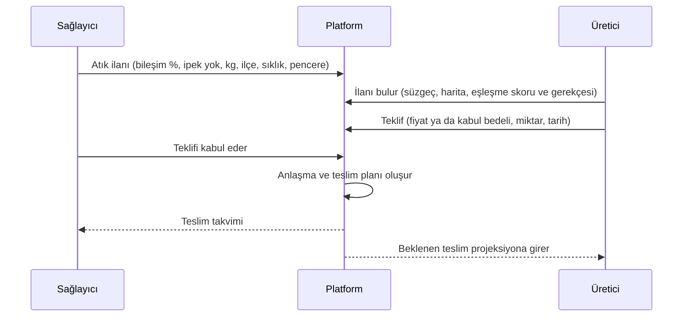

# Ürün: kapsam, kişiler ve akışlar

> Ürünün **şu anki** kapsamı. Kapsam değişince bu dosya aynı commit'te güncellenir; gerekçe `docs/DECISIONS.md` dosyasına yazılır.

## 1. Sorun ve vaat

Karışık tekstil atığı (kırpıntı, hatalı kumaş, kullanılmış giysi) çoğunlukla düzenli depolamaya ya da yakmaya gidiyor. ReBoard bu atıktan yük taşımayan iç mekân paneli üretmeyi öneriyor. Platform bu üretimin üç koşulunu yazılımla karşılar:

| Hedef | Platformdaki karşılığı | Başarı ölçüsü |
| --- | --- | --- |
| Satıcı ile alıcıyı buluşturmak | Pazar yeri: atık ve panel ilanları, teklif, anlaşma, teslim planı | İlandan anlaşmaya geçen ilan sayısı; eşleşme süresi |
| Tedarik zincirinin aksamaması | Tedarik paneli: stok, kaç günlük hammadde kaldığı, yaklaşan teslimler, uyarılar | Kırmızı eşiğe (7 günden az) düşmeden geçen gün sayısı |
| Güven | Doğrulanmış kg, gözetim zinciri, açık ürün pasaportu, hash doğrulaması | `recovered_kg_verified`; doğrulaması geçen pasaport oranı |

## 2. Kişiler

| Kişi | Örnek kurum (demo) | Ne ister | Platformda ne yapar |
| --- | --- | --- | --- |
| **Atık sağlayıcı** | Konfeksiyon A ve Örme Fabrikası B (tekstil fabrikası), Belediye Toplama C, geri dönüşüm tesisi | Atık giderini düşürmek, atığın nereye gittiğini belgelemek | Atık ilanı verir, teklifi kabul eder, teslim eder, kendi atığının panele dönüştüğünü görür |
| **Üretici** | ReBoard Pilot Tesisi | Kesintisiz ve bileşimi bilinen hammadde | Atık talebi verir, teklif eder, partiyi tartıp kabul eder, üretim partisi açar, panel ilanı verir |
| **Panel alıcısı** | Mobilya Atölyesi F, Mağaza Dekor G | Kökeni belgeli, uygun fiyatlı levha | Panel talebi verir, teklifi kabul eder, pasaportu okur |
| **Taşıyıcı** (F5) | Bölgesel nakliye | Planlı yük | MVP'de yalnızca teslim kaydındaki taşıyıcı adı ve teklif tutarı |
| **Jüri ve ziyaretçi** | | Hızlı ve dürüst bir resim | Hikâyeyi izler, etki sayacını ve pasaportu açar, "demo rolüyle gir" der |

## 3. Ana akışlar

### 3.1 Pazar yeri

- İlan türleri: `waste_offer`, `waste_request`, `panel_offer`, `panel_request`.
- Fiyat yön bağımsızdır: sağlayıcı atık için para alabilir ya da kabul bedeli ödeyebilir. Alan işaretli tutulur ve "kim kime öder" açıkça yazılır.
- Mesafe yalnızca "kuş uçuşu" etiketiyle gösterilir.
- Ekranlar: `/pazar` (süzgeç: tür, ipeksiz, sıralama; harita; kartlar), `/pazar/[id]` (ilan, teklif formu, teklifler, anlaşmalar ve teslim planı), `/pazar/yeni`.
- Tekrarlı ilanda miktar her teslim içindir. Teklif ilanın biriminde verilir, ilandaki miktarı aşamaz; ilk teslim günü pencere içinde olur (D-021).
- Tek seferlik ilan kabulde kapanır, diğer açık teklifler reddedilir. Tekrarlı ilan açık kalır.
- Kabulle anlaşma ve teslim planı oluşur: 09:00 TSİ, haftalık ya da aylık, pencere bitişine ya da 60 güne kadar.
- Eşleşme skoru gerekçesiyle gösterilir: bileşim, miktar, yakınlık, sizinle zamanında teslim. Bilinmeyen bileşen 0 sayılmaz; skorun hangi ağırlıktan hesaplandığı yazar. İpek içeren atık eşleşmez.
- Harita ilçe düzeyindeki konumu gösterir. Aynı ilçedeki ilanlar tek noktada sayıyla birleşir; dokununca ilan ya da ilan listesi açılır. Harita açılamazsa aynı bilgi listede kalır (D-022).
- Teklifleri yalnızca ilan sahibi ve teklifi veren görür. İzleyici rolü okur, ilan ya da teklif veremez.

### 3.2 İzlenebilirlik

1. **Teslim alma:** Üretici partiyi tartar. Sağlayıcının beyan ettiği kg ile tartılan kg yan yana yazılır. Nem ölçülür, ipek ve uygunsuz malzeme ayıklanır.
2. **Kanıt:** Kantar fişi ya da irsaliye yüklenir (PDF, PNG, JPEG, WebP; en fazla 4 MiB). Dosyanın SHA-256 özeti saklanır. Kanıt durumu `beyan` → `belgeli` → `mutabık` diye ilerler.
3. **Üretim partisi:** Birden çok atık partisi kütleyle bir üretim partisine tahsis edilir. Kütle dengesi denetlenir.
4. **Panel lotu:** Üretim partisinden m², yoğunluk ve test durumuyla panel lotu çıkar.
5. **Gözetim zinciri:** Her adım bir EPCIS olayı olarak hash zincirine eklenir.
6. **Pasaport:** Her panel lotunun açık bir sayfası ve QR kodu olur.

- Ekranlar:
  - `/izlenebilirlik`: teslim alınacaklar, teslim alınan partiler, sağlayıcı olarak teslim edilenler, üretim partileri ve zincir durumu.
  - `/izlenebilirlik/kabul/[teslim]`: beyan edilen kg ve lif bileşimi ilandan gelir; tartılan kg, ayıklanan kg, nem ve ipek girilir.
  - `/izlenebilirlik/parti/[id]`: beyan ile tartım farkı, kabul edilen ve kalan kg, kanıtlar (SHA-256, indirme, kontrol), tahsisler ve olay geçmişi.
  - `/izlenebilirlik/uretim/yeni`: yalnızca doğrulanmış ve kalanı olan partiler listelenir; tahsis, çıktı, fire, nem kaybı, bağlayıcı ve isteğe bağlı panel lotu girilir.
  - `/izlenebilirlik/lot/[id]`: soy ağacı (iç içe liste, D-023), lif ve sağlayıcı dağılımı, kütle dengesi, test durumu ("test edilmedi") ve olay geçmişi.
- Parti, kantar fişi ya da tartım kanıtı "belgeli" olunca doğrulanır (D-013). Ana etki sayısı bu doğrulanmış kg'dır.
- Ayıklanan kg tartılan kg'ı aşamaz. Kütle dengesi %2'yi aşarsa açıklama zorunludur. Bilinmeyen değer 0 sayılmaz, "bilinmiyor" yazar.
- Kural hatası formu silmez: uyarı çıkar, girilen değerler yerinde kalır.
- Roller: operatör teslim alır, kanıt yükler ve üretim girer; kanıtı yalnızca sahip ya da yönetici kontrol eder. İzleyici her şeyi okur, hiçbir şey yazmaz.
- Sağlayıcı, teslim ettiği partinin tartım sonucunu ve doğrulandığını görür; alıcının kanıt dosyasını ve olay geçmişini görmez.
- Kanıt dosyasını yalnızca yükleyen kurum indirir; dosya sayfa olarak açılmaz, ek olarak iner (D-018).

### 3.3 Etki ve tedarik paneli

Panel girişten sonraki ilk ekrandır (`/panel`). Kurum yalnızca kendi gördüğü kayıtlardan hesaplanan sayıları görür (D-016). Her gösterge sonuç sınıfı rozeti taşır; demo verisinde hepsi "Sentetik"tir (D-011).

- **Etki:**
  - Ana sayı doğrulanmış kg'dır: teslim alan tarafın tarttığı ve kantar fişini kontrol ettiği miktar (D-013).
  - Beyan edilen kg ve "doğrulanmış parti / toplam parti" ayrı göstergedir. Üretim yapan kurumda panele giren kg da gösterilir.
  - Kaynak dağılımı tablosu: üretici için sağlayıcılar, sağlayıcı için teslim ettiği kurumlar; kg ve pay.
  - Aylık doğrulanmış kg sütun grafiği: kurumun ilk kaydının ayından başlar, en çok 6 ay. İki aydan az veri varsa grafik çizilmez, tablo açık gelir.
  - CO₂e gösterilmez; nedeni panelde yazar (doğrulanmış katsayı kaynağı yok).
  - Kaydı olmayan kurum "0 kg" görmez; ilk parti gelince göstergelerin oluşacağını söyleyen boş durum görür.
- **Tedarik** (yalnızca hammadde teslim alan kurum):
  - Kaç günlük hammadde: üretime hazır stok ÷ planlı günlük ihtiyaç. Düzey çipi simge ve yazıyla gelir: Yeterli (14 gün ve üstü), Dikkat (7–14), Kritik (7'nin altı). Eşikler kurumun girdisinden gelir, yoksa varsayılandır; hangisi olduğu ekranda yazar.
  - Üretime hazır stok yalnızca doğrulanmış partilerin kalanıdır. Doğrulama bekleyen kg ve parti sayısı ayrı göstergedir (D-024).
  - Bilinmeyen kalem varsa toplam "en az" diye yazılır; hepsi bilinmiyorsa "bilinmiyor".
  - Uyarılar, kritikten dikkate sıralı: gün sayısı eşiğin altında; ihtiyaç girilmemiş; planlı teslimlerle bile kritik düzeye iniş günü; stokun bittiği gün; geciken teslim; doğrulama bekleyen partiler; kalanı bilinmeyen partiler; tedarik yoğunlaşması.
  - 30 günlük stok projeksiyonu çizgi grafiği: eşik çizgileri, planlı teslim noktaları ve kritik düzeye iniş günü işaretlidir. Klavyeyle (ok tuşları, Home, End) gezilir, seçilen gün ekran okuyucuya okunur.
  - Yaklaşan teslimler (30 gün) tablosu.
  - Tedarikçi güvenilirliği tablosu: zamanında teslim (oran ve adet), tartım − beyan farkı, son 90 gün payı, parti sayısı. Altında HHI ve 1.800 eşiği yazar.
- Her grafiğin altında "Tablo olarak göster" açılır tablosu vardır; grafikteki her sayı orada da bulunur.
- Kurumun izinleri sayfanın altında açılır listededir.

### 3.4 Senaryo

Şerife'nin rapordaki formülleri girdileriyle birlikte gösterilir:

- fabrika kazancı;
- panel müşterisi kazancı;
- ReBoard faaliyet sonucu;
- fiyat koridoru;
- SaaS katkısı.

Her sonuç sınıf rozetini taşır. Olumsuz senaryo gizlenmez.

## 4. MVP kapsamı (30 Ekim demosu)

| Var | Yok (D-015) |
| --- | --- |
| Hikâye sayfası ve canlı etki sayacı | Canlı GPS takibi |
| Pazar yeri: ilan, teklif, anlaşma, teslim planı | Yapay zekâ ile rota optimizasyonu |
| Parti kabulü, kanıt, üretim partisi, soy ağacı | Ödeme, emanet hesabı, fatura |
| Etki ve tedarik paneli, uyarılar | Karbon kredisi |
| Açık pasaport, QR, hash doğrulama | Blokzincir |
| Senaryo ekranı, SaaS gider hesabı | Mobil uygulama |
| TR ve EN, demo rolleri, sıfırlama | E-posta bildirimleri (F5) |

## 5. Ürün kuralları

- Demo verisinin tamamı **Sentetik** rozeti taşır.
- Kaynaklı referans değerler **Kaynaklı tahmin** rozeti taşır ve kaynağına bağlanır.
- Platform reçete, dayanım ya da maliyet üstünlüğü iddia etmez. Test durumu "test edilmedi" ise öyle yazar.
- İpek kapsam dışıdır; kabulde ayıklanır ve kaydı tutulur.
- Her kurum yalnızca kendi kayıtlarını ve paylaşılanları görür: açık ilanlar, herkese açık profiller ve lotlar, taraf olduğu teklif, anlaşma ve teslimler ve bu anlaşmaların ilanı (kapanmış olsa da). Sağlayıcı, teslim ettiği partinin tartım sonucunu görür (D-016).
- Hesaplar davetle açılır; herkese açık kayıt yoktur (D-010).
