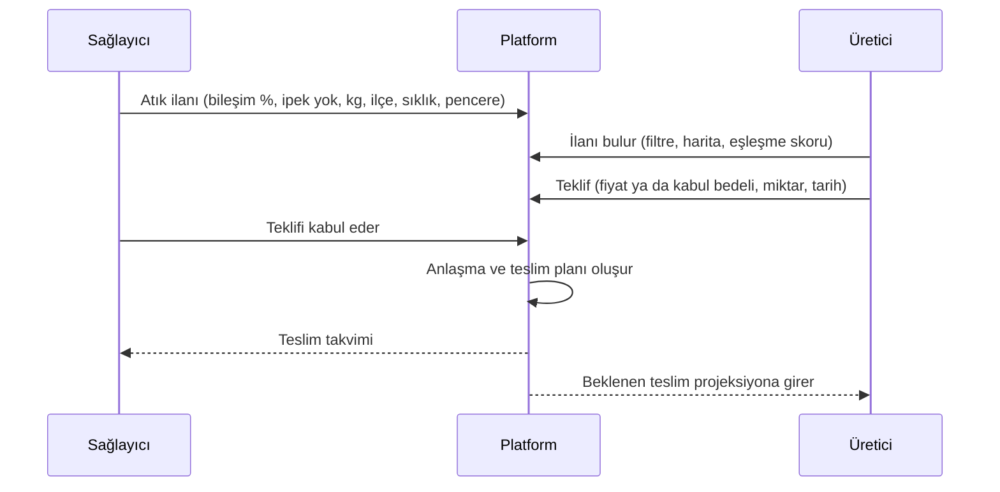

# Ürün: kapsam, kişiler ve akışlar

> Ürünün **şu anki** kapsamı. Kapsam değişince bu dosya aynı commit'te güncellenir; gerekçe `docs/DECISIONS.md` dosyasına yazılır.

## 1. Sorun ve vaat

Karışık tekstil atığı (kırpıntı, hatalı kumaş, kullanılmış giysi) çoğunlukla düzenli depolamaya ya da yakmaya gidiyor. ReBoard bu atıktan yük taşımayan iç mekân paneli üretmeyi öneriyor. Platform bu üretimin üç koşulunu yazılımla karşılar:

| Hedef | Platformdaki karşılığı | Başarı ölçüsü |
| --- | --- | --- |
| Satıcı ile alıcıyı buluşturmak | Pazar yeri: atık ve panel ilanları, teklif, anlaşma, teslim planı | İlandan anlaşmaya geçen ilan sayısı; eşleşme süresi |
| Tedarik zincirinin aksamaması | Tedarik paneli: stok, kaç günlük hammadde kaldığı, yaklaşan teslimler, uyarılar | Kırmızı eşiğe (7 günden az) düşmeden geçen gün sayısı |
| Güven | Doğrulanmış kg, gözetim zinciri, açık ürün pasaportu, hash doğrulaması | `recovered_kg_verified`; doğrulaması geçen pasaport oranı |

## 2. Kişiler

| Kişi | Örnek kurum (demo) | Ne ister | Platformda ne yapar |
| --- | --- | --- | --- |
| **Atık sağlayıcı** | Konfeksiyon A ve Örme Fabrikası B (tekstil fabrikası), Belediye Toplama C, geri dönüşüm tesisi | Atık giderini düşürmek, atığın nereye gittiğini belgelemek | Atık ilanı verir, teklifi kabul eder, teslim eder, kendi atığının panele dönüştüğünü görür |
| **Üretici** | ReBoard Pilot Tesisi | Kesintisiz ve bileşimi bilinen hammadde | Atık talebi verir, teklif eder, partiyi tartıp kabul eder, üretim partisi açar, panel ilanı verir |
| **Panel alıcısı** | Mobilya Atölyesi F, Mağaza Dekor G | Kökeni belgeli, uygun fiyatlı levha | Panel talebi verir, teklifi kabul eder, pasaportu okur |
| **Taşıyıcı** (F5) | Bölgesel nakliye | Planlı yük | MVP'de yalnızca teslim kaydındaki taşıyıcı adı ve teklif tutarı |
| **Jüri ve ziyaretçi** | | Hızlı ve dürüst bir resim | Hikâyeyi izler, etki sayacını ve pasaportu açar, "demo rolüyle gir" der |

## 3. Ana akışlar

### 3.1 Pazar yeri

- İlan türleri: `waste_offer`, `waste_request`, `panel_offer`, `panel_request`.
- Fiyat yön bağımsızdır: sağlayıcı atık için para alabilir ya da kabul bedeli ödeyebilir. Alan işaretli tutulur ve "kim kime öder" açıkça yazılır.
- Mesafe yalnızca "kuş uçuşu" etiketiyle gösterilir.

### 3.2 İzlenebilirlik

1. **Teslim alma:** Üretici partiyi tartar. Sağlayıcının beyan ettiği kg ile tartılan kg yan yana yazılır. Nem ölçülür, ipek ve uygunsuz malzeme ayıklanır.
2. **Kanıt:** Kantar fişi ya da irsaliye yüklenir (PDF, PNG, JPEG, WebP; en fazla 5 MB). Dosyanın SHA-256 özeti saklanır. Kanıt durumu `beyan` → `belgeli` → `mutabık` diye ilerler.
3. **Üretim partisi:** Birden çok atık partisi kütleyle bir üretim partisine tahsis edilir. Kütle dengesi denetlenir.
4. **Panel lotu:** Üretim partisinden m², yoğunluk ve test durumuyla panel lotu çıkar.
5. **Gözetim zinciri:** Her adım bir EPCIS olayı olarak hash zincirine eklenir.
6. **Pasaport:** Her panel lotunun açık bir sayfası ve QR kodu olur.

### 3.3 Etki ve tedarik paneli

- **Etki:**
  - Doğrulanmış kg ana sayıdır.
  - Beyan edilen kg ayrı gösterilir.
  - Panele giren kg ayrıca gösterilir.
  - Ayrıca kaynak dağılımı ve aylık trend.
- **Tedarik:**
  - Stok.
  - Kaç günlük hammadde kaldığı: 14 gün ve üstü yeşil, 7–14 gün sarı, 7 günden az kırmızı.
  - Planlı teslimlerle 30 günlük projeksiyon.
  - Tedarikçi güvenilirliği: zamanında teslim yüzdesi, beyan ile tartım farkı.
  - Tedarikçi yoğunlaşması (HHI).
  - Uyarılar.

### 3.4 Senaryo

Şerife'nin rapordaki formülleri girdileriyle birlikte gösterilir:

- fabrika kazancı;
- panel müşterisi kazancı;
- ReBoard faaliyet sonucu;
- fiyat koridoru;
- SaaS katkısı.

Her sonuç sınıf rozetini taşır. Olumsuz senaryo gizlenmez.

## 4. MVP kapsamı (30 Ekim demosu)

| Var | Yok (D-015) |
| --- | --- |
| Hikâye sayfası ve canlı etki sayacı | Canlı GPS takibi |
| Pazar yeri: ilan, teklif, anlaşma, teslim planı | Yapay zekâ ile rota optimizasyonu |
| Parti kabulü, kanıt, üretim partisi, soy ağacı | Ödeme, emanet hesabı, fatura |
| Etki ve tedarik paneli, uyarılar | Karbon kredisi |
| Açık pasaport, QR, hash doğrulama | Blokzincir |
| Senaryo ekranı, SaaS gider hesabı | Mobil uygulama |
| TR ve EN, demo rolleri, sıfırlama | E-posta bildirimleri (F5) |

## 5. Ürün kuralları

- Demo verisinin tamamı **Sentetik** rozeti taşır.
- Kaynaklı referans değerler **Kaynaklı tahmin** rozeti taşır ve kaynağına bağlanır.
- Platform reçete, dayanım ya da maliyet üstünlüğü iddia etmez. Test durumu "test edilmedi" ise öyle yazar.
- İpek kapsam dışıdır; kabulde ayıklanır ve kaydı tutulur.
- Her kurum yalnızca kendi kayıtlarını ve paylaşılanları görür: açık ilanlar, herkese açık profiller ve lotlar, taraf olduğu teklif, anlaşma ve teslimler. Sağlayıcı, teslim ettiği partinin tartım sonucunu görür (D-016).
- Hesaplar davetle açılır; herkese açık kayıt yoktur (D-010).
